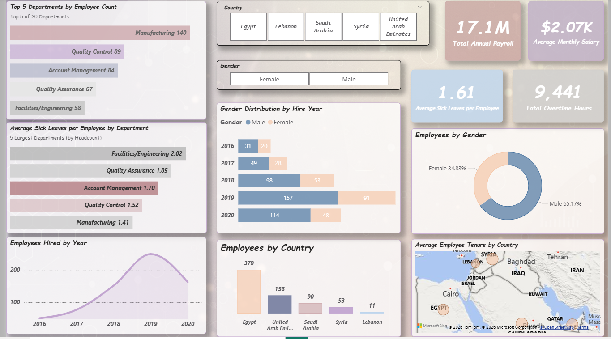
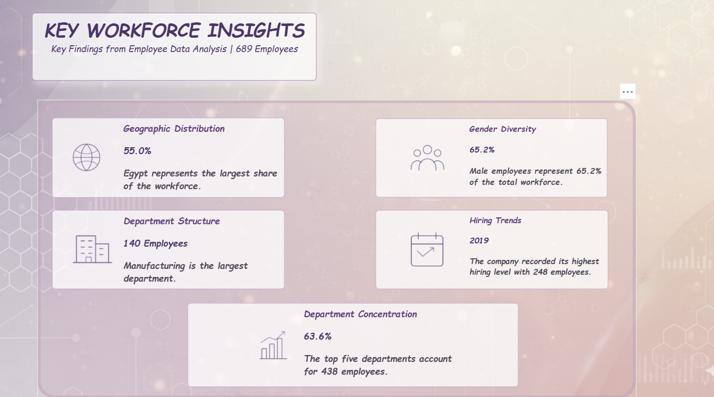
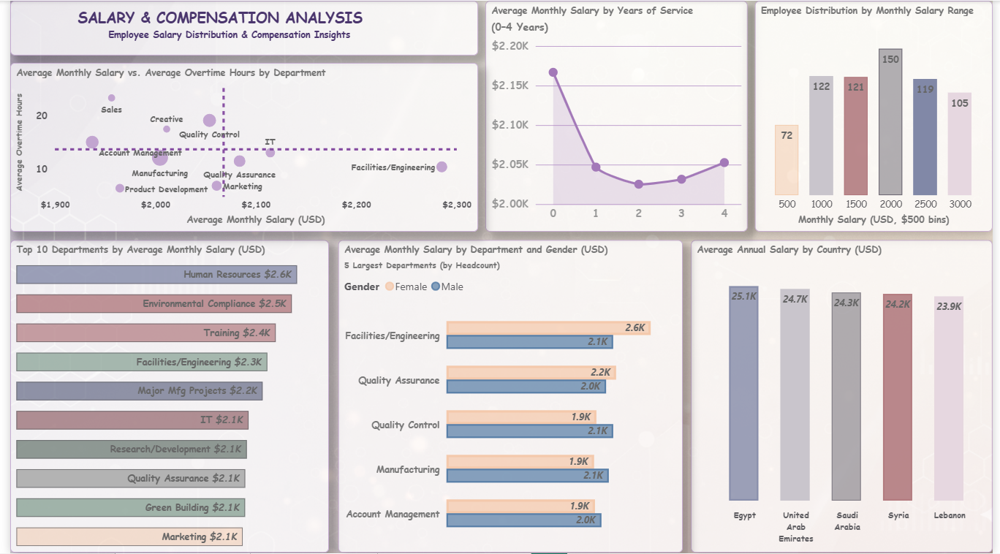

# HR Analytics Dashboard | Power BI

An interactive Power BI dashboard that analyzes employee data to understand workforce structure, hiring trends, and salary & compensation.

> Note: The dataset is a training dataset, not real company data.

## Project Goal
Turn raw employee data into clear insights that can support HR decisions: where employees work, how the workforce is built, how hiring changed over time, and how salaries are distributed.

## Dataset
- 689 employees, 20 departments, 5 countries (Egypt, UAE, Saudi Arabia, Syria, Lebanon)
- Main fields: Employee ID, Department, Country, Gender, Start Date, Years, Monthly Salary, Annual Salary, Overtime Hours, Sick Leaves

## Tools
Power BI Desktop (Power Query, DAX), Excel

## Data Preparation
- In Power Query: renamed the table to Employees, renamed column NO to Employee ID, applied Trim and Clean to text columns, and set correct data types
- Checked for duplicates: no duplicate Employee IDs
- Created a Monthly Salary Range column ($500 bins) for the salary distribution chart

## DAX Measures
Total Employees, Total Annual Payroll, Average Monthly Salary, Average Annual Salary, Total Overtime Hours, Average Sick Leaves, Average Overtime Hours

## Dashboard Pages

### 1. Workforce Overview
KPIs (total annual payroll, average monthly salary, average sick leaves, total overtime hours), headcount by department, country and gender, hiring trends by year, average tenure by country, and average sick leaves in the five largest departments.

### 2. Workforce Insights
Key findings about the workforce in short insight cards.

### 3. Salary & Compensation Analysis
Average salary by department and country, salary by years of service, salary distribution, gender comparison inside the largest departments, and salary vs. overtime.

## Key Insights

**Workforce**
- Egypt has the largest share of employees: 55.0% (379 of 689)
- Male employees are 65.2% and female employees are 34.8%
- Manufacturing is the largest department with 140 employees
- Hiring peaked in 2019 with 248 employees
- The top five departments account for 438 employees (63.6%)

**Salary and Compensation**
- Average monthly salary is about $2.07K, and total annual payroll is about $17.1M
- Average annual salary is close across countries: from $23.9K (Lebanon) to $25.1K (Egypt)
- No clear increase in average monthly salary with years of service (0 to 4 years). Employees with 5 years were excluded because there are only 2
- Salaries are spread across all ranges. The largest group is the $2,000 range (150 employees)
- Gender comparison in the five largest departments has no consistent direction. Example: in Facilities/Engineering, female average is $2,599 (20 employees) vs. $2,120 for male (38 employees). In Account Management, female average is $1,890 (35 employees) vs. $1,971 for male (49 employees)
- No clear relationship between average salary and average overtime hours among the 10 largest departments
- Average sick leaves in the five largest departments range from 1.41 (Manufacturing) to 2.02 (Facilities/Engineering)

## Limitations
- The dataset has no job title column, so differences between groups cannot be explained.
- Averages of very small groups are not reliable, so charts use filters for the largest departments and show employee counts in tooltips.

## Files
- `HR_Analytics_Dashboard.pbix`: the Power BI report
- `employee.xlsx`: the source data
- `screenshots/`: images of the three report pages

## How to Open
Download the `.pbix` file and open it with Power BI Desktop.

## Author
**Esraa Nagy** | [LinkedIn](https://www.linkedin.com/in/esraa-nagy-80b136371/)
